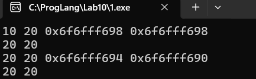
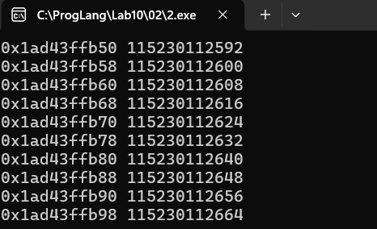
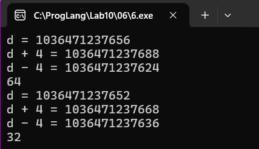
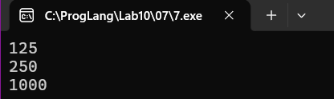
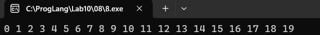
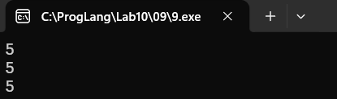
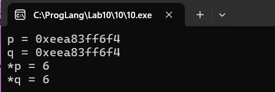

# Языки программирования
## Лабораторная работа 10

### Задание 1 **(2)**

*Рассмотрите следующие фрагменты программ. Запишите, что означают символы* **&** и  * *в каждом случае применения.*
```
int a = 10, b = 20;
int *p = &a , *q = &b;
p = q;
std::cout << *p <<' '<< *q << std::endl;
```
```
int a = 10, b = 20;
int *p = &a , *q = &b;
*p = *q;
std::cout << *p <<' '<< *q << std::endl;
```
*Чем различаются присваивания в третьей строке? Что можно вывести,
чтобы показать различия?*

*Примеры программ сохраните в папке с номером задания. Скриншоты работы прикрепите к отчету.*

**Ответ:**

В строке `int *p = &a, *q = &b;` символ * - описатель указателя (p и q имеют тип «указатель на int»), а & - оператор взятия адреса (в указатель записывается адрес переменной).

Присваивания в третьей строке различаются:
`p = q;` - присваиваются указатели. Адрес из q копируется в p, теперь оба указывают на b. Значения a и b не меняются (10 и 20).
`*p = *q;` - здесь * это оператор разыменования. Значение переменной b копируется в переменную a. Указатели не меняются, но a и b становятся равны 20.

Если вывести только *p и *q, в обоих случаях будет 20 20, разницы не видно. Поэтому нужно дополнительно вывести a, b, p и q. В первом случае p и q совпадают, а a и b остались 10 и 20. Во втором случае p и q разные, а a и b равны 20.



### Задание 2 **(1)**

*Рассмотрим следующую программу.* 
```
double x[10];
for (int i = 0; i <10; i++)
    std::cout << &x[i] << std::endl;
```
*Что она выводит? Измените
вывод так, чтобы адреса выводились в десятичной системе счисления.
Объясните почему числа составляют арифметическую прогрессию с
определенным шагом.*

*Записанную программу сохраните в папке с номером задания.*
*Скриншоты работы прикрепите к отчету.*

**Ответ:**

Программа выводит адреса десяти элементов массива x в шестнадцатеричном виде, по одному в строке

Адреса образуют арифметическую прогрессию с шагом 8, потому что элементы массива лежат в памяти подряд, а тип double занимает 8 байт. Адрес x[i] равен адресу начала массива плюс i * sizeof(double).



### Задание 3 **(2)**

*Токен* **«*»** *в языке C++ может использоваться в трех различных
случаях. Аналогично токен* **«&»** *также может использоваться в трех
случаях. Приведите пример одной программы в которой они были бы
использованы во всех случаях.*

*Записанную программу сохраните в папке с номером задания.*

### Задание 4 **(2)**

*Выпишите значения всех переменных, в том числе указателей,
после выполнения каждой инструкции программы. Объясните, что
происходит в результате выполнения каждой инструкции.*
```
unsigned a = 8, b = 3 ,c = 17;
unsigned *p = &a;
unsigned *q = &b;
*p += *q + c;
c = *q;
p = &c;
c += a;
*p += 10;
*q = *p;
q = p ;
*q += 10;
```

**Ответ:**

- `unsigned a = 8, b = 3, c = 17;` создаются три переменные типа unsigned с начальными значениями.
- `unsigned *p = &a;` в указатель p записывается адрес переменной a.
- `unsigned *q = &b;` в указатель q записывается адрес переменной b.
- `*p += *q + c;` *p это a, *q это b. Выполняется a = a + (b + c) = 8 + (3 + 17) = 28.
- `c = *q;` *q это b, поэтому c = b = 3.
- `p = &c;` указателю p присваивается новый адрес, теперь он указывает на c. Значения переменных не меняются.
- `c += a;` c = c + a = 3 + 28 = 31.
- `*p += 10;` *p теперь это c, поэтому c = 31 + 10 = 41.
- `*q = *p;` *q это b, *p это c. Значение c копируется в b, b = 41.
- `q = p;` указателю q присваивается адрес из p, теперь оба указывают на c. Значения переменных не меняются.
- `*q += 10;` *q теперь это c, поэтому c = 41 + 10 = 51.

Итог: a = 28, b = 41, c = 51, указатели p и q указывают на c.

### Задание 5 **(1)**

*Что сравнивается в приведенной ниже программе? Как можно
изменить первую строчку программы, чтобы результат тоже
изменился?*
```
int x = 1, y = 2;
int *p = &y, *q = &x;
if (p < q)
    std::cout << "Yes";
else
    std::cout << "No";
```
**Ответ:**

Сравниваются адреса, которые хранятся в указателях p и q.

Чтобы результат изменился, нужно изменить порядок объявления переменных в первой строке. x объявляется позже y и, как правило, получает меньший адрес, поэтому q станет меньше p, условие p < q станет ложным и выведется No.


### Задание 6 **(2)**

*Объясните работу следующей программы. Как изменится
результат, если тип* **double** *изменить на некоторый другой, например*
**int** *или* **char**?
```
double x = 0;
double *d = &x;
std::cout << reinterpret_cast<size_t>(d + 4) - reinterpret_cast<size_t>(d - 4) << std::endl;
```

**Ответ:**

При прибавлении или вычитании числа к указателю происходит перемещение на указанное количество элементов этого типа.

Вывод с double, потом с int:



### Задание 7 **(2)**

*Объясните работу следующей программы. Как изменится
результат, если тип* **double** *изменить на некоторый другой, например*
**int** *или* **char**?
```
std::cout << reinterpret_cast <double*>(3000) - reinterpret_cast <double*>(2000) << std::endl;
```

**Ответ:**

В программе целые числа 3000 и 2000 с помощью reinterpret_cast преобразуются в указатели на double, то есть в адреса 3000 и 2000. Обращения по этим адресам нет, выполняется только вычитание указателей. Разность двух указателей типа type* равна разности адресов, делённой на sizeof(type). Для double это (3000 - 2000) / 8 = 1000 / 8 = 125. Программа выводит 125.

Если заменить тип:
int (4 байта): 1000 / 4 = 250
char (1 байт): 1000 / 1 = 1000

Вывод double, int, char:



### Задание 8 **(2)**

*Что надо дописать в записанной ниже программе вместо многоточий, чтобы
она выводила все числа из массива* **a**? *Почему?*
```
int a[20];
for ( int i = 0; i < 20; i++)
    a[i] = i;
int *b=a + 8;
for (int i =...; i <...; i++)
    std::cout << b[i] <<' ';
```

**Ответ:**

Надо написать `for (int i = -8; i < 12; i++)`

Указатель b = a + 8 указывает на a[8], а b[i] равно *(b + i), то есть a[8 + i]. Чтобы вывести a[0] ... a[19], нужно, чтобы 8 + i менялось от 0 до 19, поэтому i меняется от -8 до 11. Отрицательные индексы допустимы, потому что смещение отсчитывается от места, на которое указывает b, а не от начала массива.




### Задание 9 **(2)**

*Что выводит следующая программа? Изменится ли результат если
изменить тип элементов массива?*

```
int a[10];
std::cout << &a[8] - &a[3] << std::endl;
```

**Ответ:**

Разность указателей равна разности адресов, делённой на размер типа элемента. Между &a[8] и &a[3] лежит 5 элементов: для int адреса отличаются на 20 байт, и 20 / 4 = 5. Программа выводит 5.

Если изменить тип элементов, результат не изменится. Размер типа входит и в разность адресов, и в делитель, поэтому сокращается.

Вывод для int, double, char:



### Задание 10 **(1)**

*Есть ли разница между инициализацией* **p** и **q** *в следующей программе? Обоснуйте ответ.*
```
int x [10]={1, 2, 3, 4, 5, 6, 7, 8, 9, 10};
int *p = x + 5;
int *q = &x[5];
```
**Ответ:**

Разницы нет. p и q содержат один и тот же адрес, адрес элемента x[5]. x + 5 - это смещение указателя на начало массива на 5 элементов. &x[5] - это &*(x + 5), то есть адрес того же элемента.




### Задание 11 **(3)**

*Указатели можно использовать для итерации по массивам.
Напишите программу, которая найдет сумму элементов массива,
используя указатели. В начале цикла указатель требуется установить
на начало массива, в конце каждой итерации смещать его к
следующему элементу массива через инкремент. Для выхода из цикла
надо проверять, что указатель дошел до конца массива.*
```
int x [10]={1, 2, 3, 4, 5, 6, 7, 8, 9, 10};
int s = 0;
for (int *p = ...; ...; ...)
    s += ...
std::cout << s;
```

*Записанную программу сохраните в папке с номером задания.*
